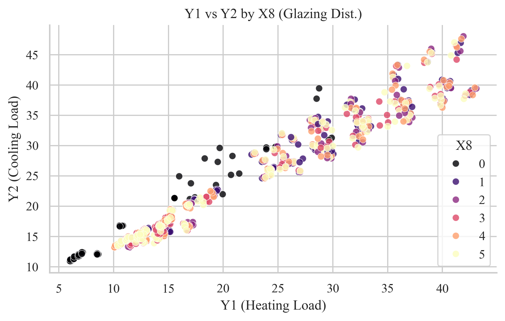
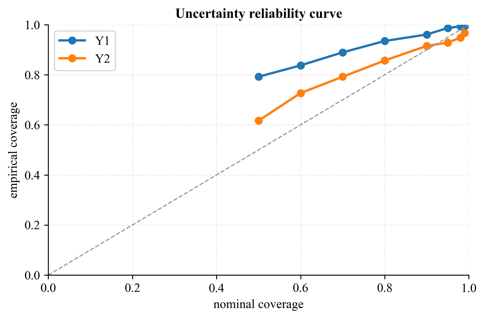
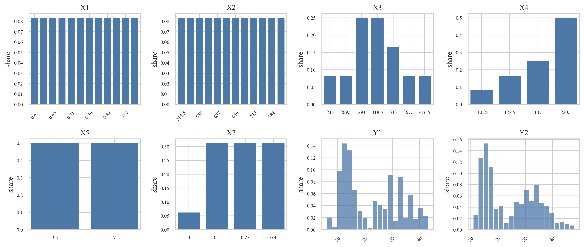

# Probabilistic Building Energy Prediction

Heating and cooling load prediction for building designs, with an uncertainty estimate for each prediction.

[](https://github.com/jacobemanuel/building-energy-gpr/actions/workflows/tests.yml)

The question was whether a probabilistic model can predict building loads accurately and also show when a prediction is less reliable.

I built a leakage-safe evaluation pipeline for heating and cooling load on the [UCI Energy Efficiency benchmark](https://doi.org/10.24432/C51307). Ridge regression, a 300-tree random forest and exact Gaussian Process Regression all get tested on the same held-out splits. Besides point accuracy I check the native Gaussian predictive intervals empirically and compare them with a separate split-conformal coverage check.

**In short:** on held-out designs the random forest explained 99.7% of the variance in heating load and the Gaussian process 97.6% in cooling load. The Gaussian process also gives a range with each prediction, and its 90% ranges held 91.6% of the true cooling loads, close to target. For heating they were too cautious and held 96.1%. The models themselves are standard scikit-learn ones. My work is the evaluation around them.

> Course project for *Python for Engineering Data Analysis - From Machine Learning to Visualization*, Technical University of Munich.

## At a glance

- **Data:** 768 simulated designs, 8 input variables, 2 regression targets, no missing or duplicate rows
- **Targets:** heating load (`Y1`) and cooling load (`Y2`)
- **Models:** RidgeCV, Random Forest and exact Gaussian Process Regression
- **Primary split:** fixed 80/20 holdout with seed 42
- **Stability check:** 10 repeated random 80/20 holdouts with seeds 1 to 10
- **Uncertainty:** empirical diagnostics for native Gaussian intervals plus a separate split-conformal check
- **Reproducibility:** saved split indices, configuration, predictions, metrics and generated figures
- **Verification:** 11 automated tests covering data, metrics, pipeline behavior and artifacts

## The setup

The dataset is a structured Ecotect simulation grid. It doesn't come from measurements of real buildings. The inputs cover relative compactness, surface and wall area, roof area, overall height, orientation, glazing area and glazing-area distribution.

Orientation and glazing distribution are nominal variables. That's why the main pipeline one-hot encodes them instead of treating their numeric labels as if the distances between them meant something. Continuous variables get standardized. Every preprocessing step lives inside a scikit-learn `Pipeline` and only gets fitted on the training partition.

All models and targets share the same outer split. That way the point-error comparison stays direct and there's no preprocessing leakage. I save the split indices, model configuration, held-out predictions and evaluation metrics so every public number can be traced back to a generated artifact.



*Heating and cooling loads form a strongly structured design grid. Color shows the glazing-area distribution.*

## Models

- **RidgeCV** gives me a regularized linear baseline.
- **Random Forest** is there as a strong nonlinear point-prediction baseline.
- **One-hot GPR** is the primary probabilistic model and the one I use in the main analysis.
- **Numeric-encoding GPR** stays in as an ablation. It does improve some point metrics. But it imposes an unjustified ordinal geometry on nominal categories, so I don't treat it as the primary model.

The Gaussian process uses a constant times a Matern-3/2 kernel, plus a `WhiteKernel` residual component. On deterministic simulation data that component should be read as model lack of fit or numerical tolerance. It isn't an empirical decomposition of real-world aleatoric uncertainty.

## Results on the fixed split

Fixed 80/20 holdout with seed 42:

| Target | Model | MAE | RMSE | R2 | Native 90% coverage | Native 95% coverage |
|---|---|---:|---:|---:|---:|---:|
| Heating load (`Y1`) | Random Forest | **0.367** | **0.533** | **0.9973** | n/a | n/a |
| Heating load (`Y1`) | GPR | 0.518 | 0.703 | 0.9953 | 96.1% | 98.7% |
| Cooling load (`Y2`) | Random Forest | 1.270 | 2.035 | 0.9553 | n/a | n/a |
| Cooling load (`Y2`) | GPR | **1.038** | **1.497** | **0.9758** | 91.6% | 92.9% |

Random Forest was more accurate on heating load. GPR was more accurate on cooling load and also gives a model-based uncertainty estimate, so the report keeps both.


*Held-out predictions from the primary one-hot GPR. The orange line is just the identity reference and wasn't fitted to the data.*

## Repeated splits

I checked the primary result across 10 repeated random 80/20 holdouts. The numbers below are mean plus or minus standard deviation for the one-hot GPR.

| Target | MAE | RMSE | R2 |
|---|---:|---:|---:|
| Heating load (`Y1`) | 0.536 +/- 0.044 | 0.719 +/- 0.063 | 0.995 +/- 0.001 |
| Cooling load (`Y2`) | 1.084 +/- 0.114 | 1.502 +/- 0.233 | 0.974 +/- 0.008 |

These are repeated random holdouts, and that design decides what the spread in the table means.

## Checking the uncertainty

I evaluated the predictive standard deviations from GPR using empirical coverage, reliability curves and standardized residuals. For heating load the native intervals were conservative. For cooling load the 90% coverage was close to nominal. The 95% coverage came in at 92.9%, so there's mild undercoverage at that level.



*Empirical coverage of native Gaussian intervals. Points above the diagonal mean conservative intervals and points below it mean undercoverage.*


I also ran a separate split-conformal sensitivity check. It used an absolute-residual calibration set taken from the outer training partition. On the untouched test set it gave:

| Target | 90% nominal | 95% nominal |
|---|---:|---:|
| Heating load | 94.8% empirical coverage | 97.4% empirical coverage |
| Cooling load | 89.6% empirical coverage | 95.5% empirical coverage |

These are finite-sample marginal coverage checks under the conformal exchangeability assumption. They don't claim conditional calibration or causal validity, and they don't mean the model is ready for real buildings.

<details>
<summary>Additional view: feature and target distributions</summary>



</details>

## Reproduce the analysis

The reported pipeline runs on CPU. I tested it from a clean checkout.

```bash
python3 -m venv .venv
source .venv/bin/activate
python3 -m pip install -r requirements.txt

python3 -m src.eda
python3 -m src.train
python3 -m src.evaluate
python3 scripts/conformal_check.py
python3 scripts/repeated_splits.py --repeats 10 --start-seed 1

python3 -m pytest tests/ -q
```

There's also an optional GPyTorch backend. It's experimental and isn't part of the reported scikit-learn results.

## Repository map

```text
src/                 data loading, preprocessing, training and evaluation
scripts/             robustness, conformal and artifact-generation utilities
tests/               data, metrics, integration and artifact checks
outputs/metrics/     persisted configurations and numerical results
outputs/predictions/ held-out predictions for every model and target
outputs/figures/     generated diagnostics used in this README and report
report/              public technical report and supplementary appendix
```

## Reports

- [Technical report](report/report.pdf)
- [Supplementary appendix](report/appendix.pdf)

The public PDFs keep the academic content but leave out private university identifiers. This README links every headline result to a reproducible output.

## Scope and limitations

This is a clean simulation grid. A real building is a lot messier. Random holdouts mainly test interpolation inside that grid. They say little about unseen real buildings. The benchmark is useful for comparing pipelines and uncertainty behavior. But it doesn't reproduce sensor noise, occupancy shifts, weather uncertainty or changes in building stock.

Exact GPR is practical here because `n = 768`. Its cubic training cost means it won't scale to very large datasets as is. The model comparison is compact and reproducible on purpose. I didn't try to turn it into a state-of-the-art hyperparameter competition.

## Data attribution

Tsanas, A. and Xifara, A. (2012). *Energy Efficiency* [Dataset]. UCI Machine Learning Repository. [DOI: 10.24432/C51307](https://doi.org/10.24432/C51307). Licensed under [CC BY 4.0](https://creativecommons.org/licenses/by/4.0/).
