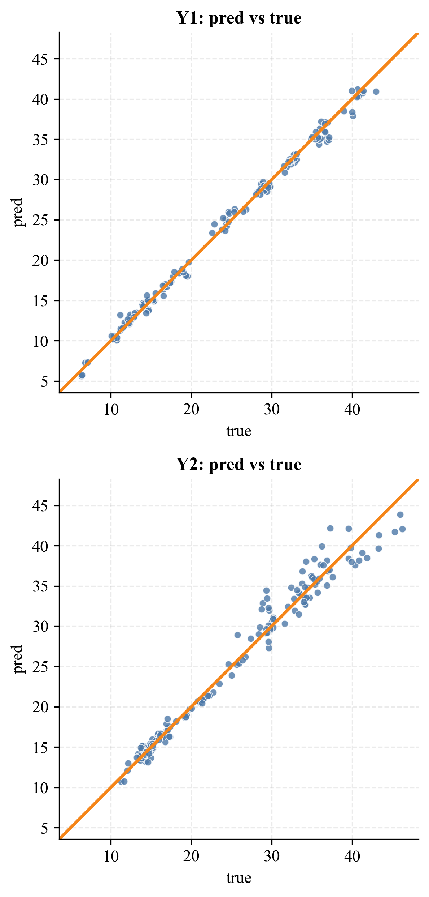
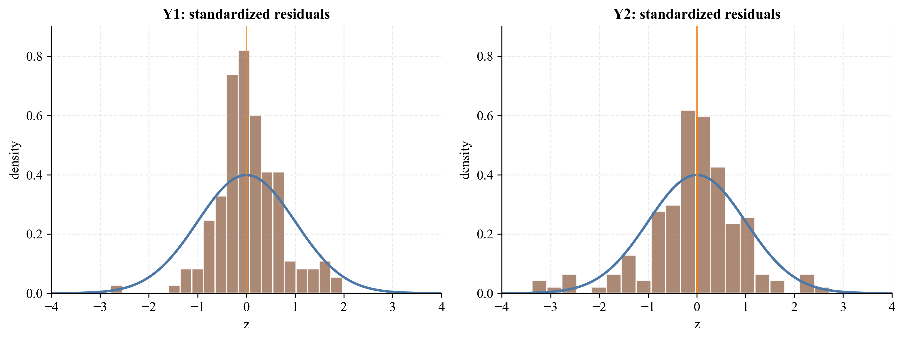

# Probabilistic Building Energy Prediction

Exact Gaussian processes, uncertainty diagnostics and reproducible evaluation on a controlled building-design grid.

[](https://github.com/jacobemanuel/building-energy-gpr/actions/workflows/tests.yml)

How much can a surrogate model tell us about a building before a full simulation is worth running?

I built a Gaussian Process Regression pipeline to estimate heating and cooling load across 768 simulated building designs. The goal was not only to reduce prediction error. I also wanted to check whether the model's uncertainty could be trusted, so I evaluated Gaussian predictive intervals, ran a separate split-conformal coverage check and compared the model with ridge regression and a 300-tree random forest.

> M.Sc. research project, Management and Technology, Technical University of Munich.

## At a glance

- 768 simulated building configurations, 8 input features and 2 prediction targets
- leakage-safe scikit-learn pipelines fitted on training data only
- RidgeCV, Random Forest and exact Gaussian Process Regression
- fixed 80/20 holdout plus 10 repeated random holdouts
- Gaussian interval diagnostics and a separate split-conformal check
- persisted splits, predictions, metrics and figures
- 11 automated tests covering data, metrics, pipeline behavior and generated artifacts

## Main results

| Target | Model | MAE | RMSE | R2 |
|---|---|---:|---:|---:|
| Heating load (Y1) | GPR | 0.518 | 0.703 | 0.995 |
| Cooling load (Y2) | GPR | 1.038 | 1.497 | 0.976 |

The ranking was not identical for both targets. Random Forest produced the lowest heating-load point error, while GPR performed better on cooling load and supplied model-based uncertainty estimates. I kept that trade-off visible instead of presenting one model as a universal winner.

Across 10 repeated random holdouts, the one-hot GPR reached `R2 = 0.995 +/- 0.001` for heating and `0.974 +/- 0.008` for cooling.



## Method

The [UCI Energy Efficiency dataset](https://doi.org/10.24432/C51307) contains simulated heating and cooling demand for a structured grid of building geometries and glazing configurations.

Orientation and glazing distribution are nominal variables, so the main pipeline one-hot encodes them rather than treating their numeric labels as meaningful distances. Continuous variables are standardized. Every preprocessing step remains inside a `Pipeline` and is fitted on the training partition only.

The Gaussian process uses a constant multiplied by a Matern-3/2 kernel, plus a white-noise component. A numeric-encoding variant is retained as an ablation: it improves some point metrics but imposes an unjustified ordinal structure on nominal categories.

The same outer split is shared across models and targets. Split indices, configuration, predictions and metrics are saved so every number in the public summary can be traced back to an artifact.

## Uncertainty, checked rather than assumed

Native Gaussian predictive intervals were evaluated through empirical coverage, reliability curves and standardized residuals. They were conservative for heating load and showed mild 95% undercoverage for cooling load.

A separate split-conformal check used a calibration subset drawn from the training partition. On the held-out test set it produced:

| Target | 90% nominal | 95% nominal |
|---|---:|---:|
| Heating load | 94.8% empirical coverage | 97.4% empirical coverage |
| Cooling load | 89.6% empirical coverage | 95.5% empirical coverage |

These are marginal coverage checks under the conformal exchangeability assumption. They are not a claim of conditional calibration or deployment readiness on real buildings.



## Reproduce the analysis

The main pipeline runs on CPU and was validated from a clean checkout.

```bash
python3 -m venv .venv
source .venv/bin/activate
python3 -m pip install -r requirements.txt

python3 -m src.eda
python3 -m src.train
python3 -m src.evaluate
python3 scripts/conformal_check.py
python3 scripts/repeated_splits.py --repeats 10 --start-seed 1

python3 -m pytest tests/ -q
```

The optional GPyTorch backend is separate from the reported scikit-learn results.

## Repository map

```text
src/                 data loading, preprocessing, training and evaluation
scripts/             robustness, conformal and artifact-generation utilities
tests/               data, metrics, integration and artifact checks
outputs/metrics/     persisted configurations and numerical results
outputs/predictions/ held-out predictions for every model and target
outputs/figures/     generated diagnostics used in this README and report
report/               public report and supplementary appendix
```

## Report

- [Technical report](report/report.pdf)
- [Supplementary appendix](report/appendix.pdf)

The public PDFs preserve the scientific content while omitting private university identifiers.

## Scope and limitations

The dataset is a controlled Ecotect design grid. Random holdouts primarily test interpolation within that grid, not generalization to unseen real buildings. The model comparison is deliberately compact and reproducible rather than a state-of-the-art hyperparameter competition.

Exact GPR is practical here because `n = 768`; its cubic training cost will not scale unchanged to very large datasets. The white-noise term is part of a predictive model on deterministic simulation data and should not be interpreted as a measured decomposition of real-world aleatoric uncertainty.

## Why it belongs in my research portfolio

Most of my current engineering work is in XR, but the research pattern is the same: define a measurable question, build the apparatus, prevent leakage, compare honest baselines, inspect uncertainty and document enough for someone else to reproduce the result.

## Data attribution

Tsanas, A. and Xifara, A. (2012). *Energy Efficiency* [Dataset]. UCI Machine Learning Repository. [DOI: 10.24432/C51307](https://doi.org/10.24432/C51307). Licensed under [CC BY 4.0](https://creativecommons.org/licenses/by/4.0/).

## Author

**Jakub Majewski**

[github.com/jacobemanuel](https://github.com/jacobemanuel)
